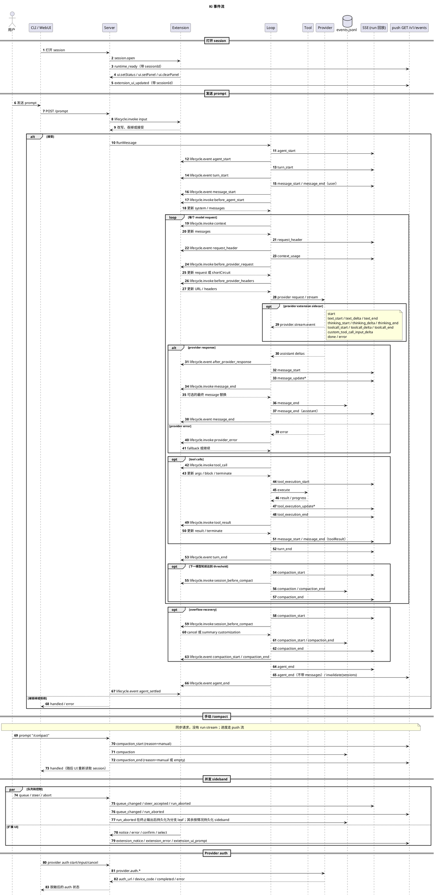

# 事件目录

本文汇总 ki 当前使用的事件名。HTTP SSE 的事件名同时出现在 `event:` 字段和 JSON 的 `type`
字段中。`lifecycle.event`、`provider.stream.event` 等 RPC 方法名只是传输方式，不是事件名。

## 通道

| 通道 | 方向 | 事件名来源 |
|---|---|---|
| Session SSE / `loop.Event` | server → CLI/WebUI | 下表的 `type`，也承载 session sideband |
| Extension lifecycle | host → extension sidecar | `lifecycle.invoke`（同步）或 `lifecycle.event`（异步） |
| Provider stream | provider sidecar → host | `provider.stream.event.type` |
| Provider auth | provider sidecar → host | `provider.auth.event.type` |
| WebUI push / `GET /v1/events` | server → WebUI | 每个 tab 一条：`invalidate` 与 `ready`，以及带 `sessionId` 的 session sideband |

`invalidate` 的 `scope` 为 `sessions` / `workspaces` / `providers` / `extensions`，只表示
「去重取」，数据仍走原 REST。push 流上的 session sideband 包括 `extension_ui_updated`、
`runtime_ready`、`run_aborted`、`queue_changed`、`compaction_start`/`compaction_end`、run
结束的 `agent_end`，以及 run 之外手动 `/compact` 后立即重算的 `context_usage`。这些不进
occupy 回放（`ready` 后客户端自行全量重取，重连靠它追平）；WebUI 用它们刷新侧栏、
workspaces、扩展目录，并给后台完成的 session 发系统通知。

## Session SSE

以下是 Host 侧的 session 事件名。一次运行通常按时序发生；sideband 事件可以并发到达。

| 分组 | 事件名 | 含义 |
|---|---|---|
| Run 和 turn | `agent_start`、`agent_end`、`turn_start`、`turn_end` | Run/turn 边界；`agent_end` 结束普通运行 SSE 回放 |
| 请求 | `request_header`、`context_usage` | 面向模型的 system/tools 快照和上下文压力 |
| 消息 | `message_start`、`message_update`、`message_end` | 用户、assistant、tool result 消息；assistant 增量通过 update 流式发送 |
| 工具执行 | `tool_execution_start`、`tool_execution_update`、`tool_execution_end` | 工具开始、进度和结束 |
| Patch 预览 | `patch_apply_updated` | `apply_patch` 参数仍在生成时的非执行语法预览；最终执行结果覆盖预览 |
| 压缩 | `compaction_start`、`compaction_end` | preflight、overflow recovery、threshold、手动 `/compact`，以及 Responses server-side compaction |
| 队列和控制 | `queue_changed`、`steer_accepted`、`run_aborted` | 队列变化、实时 Inbox 接收和中止 |
| 异步问题 | `question_requested`、`question_updated` | 已持久化的问题批次及单题状态；不阻塞当前 run |
| 扩展 UI/状态 | `extension_error`、`extension_notice`、`extension_ui_prompt` | 扩展失败、toast，或 WebUI 确认/选择弹层 |
| Runtime | `runtime_ready` | session 打开时的扩展视图准备结束；成功或失败都会解锁 session |
| 仅扩展生命周期 | `agent_settled` | `agent_end` 后 Host 收尾完成；发送给 lifecycle subscriber，不进入普通运行 SSE |
| WebUI push | `extension_ui_updated` | 扩展 status/panel/prompt 投影变化；客户端重新读取 session。它不是 `loop.EventType` 常量，只在 `GET /v1/events` 上带 `sessionId` 下发 |

### 压缩事件

`compaction_start` / `compaction_end` 在 run SSE 和 standalone push 路径都先持久化，再携带
该 lifecycle entry 的 `lifecycleEntryId`、`parentId`（根为显式空字符串）和 `timestamp`
（Unix 毫秒）。客户端据此合并回放和历史正文，不另造进度行身份；`compaction_end.entryId`
仍指向成功提交的 checkpoint，不能用作 lifecycle entry 的身份。

`reason` 保持触发原因；end 另带 `status=committed|empty|cancelled|failed`、`strategy`、
`fromExtension`、cut/token/usage 元数据，overflow 带 `willRetry=true`。

### 队列与控制事件

`question_requested` 的 `questions[]` 包含稳定的 `questionItemId`、原问题、顺序、revision、
来源分支和提问时固定的安全快照 entry 引用；私有资源、补充用户正文和配置不通过事件返回。
`question_updated` 的 `question` 是单题完整公开投影，包含提交时可选的
`answerForm: {selected, text}`，用于只读恢复原回答表单；该字段与 session GET 的回执一致，
客户端按 ID 和 revision 合并；事件发生前先写 jsonl。普通工具结果仍精确为
`{"accepted":true}`，不是状态存储协议。

问题事件不代表 assistant 结束或等待用户。`pending`、`answer_queued`、`answered` 和
`dismissed` 与主 run 状态独立：`answered` 只表示带对应 `questionReply` /
`clientRequestId` 的 user message 已持久化，不表示模型已读取或采纳。session GET 返回
独立于 transcript 分页的 `questions`，刷新及 SSE 恢复不依赖工具行是否已经加载。
旁聊有自己的 session/run/SSE，关闭窗口不取消；任何旁聊回复都不会自动成为主会话答案。

`run_aborted` 的 `reason` / `cancelSource` 记录权威取消入口和诊断客户端。事件先实时发布，
loop 写完终止输出后再以普通非 message leaf 持久化 `reason` / `source`，因此历史视图能在
正确分支和顺序中单独显示它。对应的 aborted assistant message 也保存 `cancelReason` /
`cancelSource`，诊断不必从 `context canceled` 猜原因。

`steer_accepted` 不是 JSONL leaf（run 在 drain 前被 abort 时，待处理 steer 会作为未回复的
user turn 落盘）。parent 的 run 还活着时，子代理完成通知也走这条 Inbox 路径（于是它以
`steer_accepted` 先到 push、随后由 drain 产生 `message_*`），run 已结束才落到
`queue_changed` + durable queue。

WebUI 的 stop 请求发送 `source=webui`，CLI 的 Ctrl+C 发送 `source=cli`；未声明来源的 HTTP
调用记为 `api`。服务端同时向 `{KI_HOME}/ki.jsonl` 写 `run abort requested`，带
`session_id`、`run_id`、`reason`、`source`。

### 时间戳

`tool_execution_start` 带 `timestamp`（Unix 毫秒）作为调用开始时间；`tool_execution_end`
带完成时间 `timestamp` 和 `durationMs`。耗时覆盖工具执行及 `AfterTool`；校验、拦截和未知
工具也会产生有计时的成对事件和 toolResult。toolResult message 会携带同一组
`timestamp` / `durationMs` 并落入 jsonl；start/end 本身仍是实时事件，不单独生成
conversation entry。

`durationMs` 不做 `omitempty`：亚毫秒的调用（例如读小文件的 `Read`）真实测得 0，字段必须
保留，否则 WebUI 会把「0ms」误当成「无计时」而不显示。

`turn_start` 带开始时间 `timestamp`，`turn_end` 带完成时间 `timestamp` 和 `durationMs`
（从 `turn_start` 起算的墙钟，覆盖本轮全部请求与工具）。这两个事件仍是实时边界，不落
jsonl。WebUI 运行中的耗时按该轮开头 user 消息的 `timestamp` 起算（与
`turn_start.timestamp` 同一时刻），结束后改用该轮最后一个节点的时间戳（工具行按
`startedAt + durationMs` 计入尾部），reload 后同样重算。

### 消息身份

`message_end` 带持久化后的 `entryId` 和 `parentId`（根为显式空字符串）。稀疏快照的 leaf
可能没有正文，客户端不能把收到的同一个 leaf id 当成自己的 parent；已完成 SSE 消息立即
并入身份图，使用真实 parent 边，未取得中间 metadata 时另设本地阅读桥。

Prompt JSON 接受可选 `clientRequestId`；accepted HTTP response 与持久化/SSE `Message` 携带
同一值。缺失时由 server 生成。`queued[].clientRequestId` 在队列提升后仍然保留，提升请求
不能替换原身份。`steer_accepted` 同时携带该身份和 `origin`（人工输入，含扩展中继）。

runtime 生成的和 context-only 的 Inbox 输入不发布乐观接受行：run 结束时它们可能仍未
drain。相同文本不构成确认关系。内部排队的 follow-up 也保留 ID。

Agent 完成携带 `completion:{taskId,generation}` 和由该对派生的稳定 `clientRequestId`。
入队完成**不**发 `steer_accepted`：代次交付在持久化时提交。只有成功的 message drain 才发布
其 `message_start`/`message_end`；被抑制的完成不留乐观 ghost。`queue_changed` 和普通
session invalidation 仍会唤醒客户端去取 durable delivery。

这些身份字段是传输 metadata，在 provider 请求前剥离。带 `through` 的快照回放只在
`clientRequestId` 已持久化在快照分支上时覆盖 user `message_start` 和 `steer_accepted`；
这也覆盖「先持久化、后入缓冲」的区间——单靠序号截断不能证明已接受的 Inbox 输入被 drain。

只有内容级的 `message_end` 扩展重写不能替换 `clientRequestId`、`completion` 或 `origin`；
持久化和 SSE 保留已接受的来源。

### 诊断投影

assistant `message_end` 可在外层事件携带 `cacheMiss: {missedTokens, missRatio}`；它由 server
按完整 active leaf 的前序 assistant usage 计算，compaction 后重置，REST session Entry 使用
同一投影。它是 view-only 诊断，不属于 `message` / provider `Usage`，也不写入 JSONL。
WebUI 直接按 entry id 展示该值，不从稀疏历史窗口猜测前序 baseline。

Runtime user-role 通知不占 compact 回复的 `keep` 名额，但仍可折叠：只用正常 assistant 和
按调用 ID 去重的 tool 确定首个保留或 live 回复的边界，边界之前的通知随旧回复一起进入
`hiddenCount`，边界及之后的通知按持久化顺序显示。因此 `keep=1` 不会让尾随通知挤掉最后
assistant，也不会让中途通知全部展开；`keep=0` 且无 live 回复时折叠全部通知和普通回复。
压缩/中止等生命周期元数据始终单独显示。

Code Mode 的嵌套执行是例外：复用 `tool_execution_start/update/end`，但带 `parentCallId`、
`cellId` 以及父进程生成的 `toolCallId`，以有界结构化 details 先持久化，再携带该审计 entry
的 `entryId`/`parentId` 发布。它们不生成独立 provider toolResult；只有外层 exec/wait 与
模型调用配对。`notify` 的进度使用外层调用 ID，并保留 cell/parent 归属。WebUI 直播与历史
折叠同一组事件，不会在刷新后把嵌套调用变成未配对或丢失的工具行。事件漏斗串行化这些并发
callback 和普通 loop 事件；审计失败阻止新效果或使正在运行的 cell 失败。

### 持久化范围

`message_end`、`request_header`、`context_usage`、压缩事件、工具进度、patch 预览和部分
sideband 会按各自的 server 路径持久化。并非每个 SSE 事件都会推进 conversation leaf。

## 回放

`GET /v1/sessions/{id}/events` 是某个 run 的有序回放（`agent_end` 结束）。

### 生命周期

终止 `agent_end` 在匹配的 `release` 完成排队资源重载、关闭 done 后才交给 SSE 客户端，避免
客户端立即续跑/压缩收到伪 busy。

已完成回放在 server 中最多保留 2 分钟、全局 16 MiB / 256 个；单轮超过总预算不保留，活动
run 不参与淘汰。独立定时器在没有新请求时也释放过期缓存。淘汰只移除 server 所有权，已连接
读者继续排空，不清空其缓冲，也不删除同 session 的替代 run。完成后 sideband 不再扩充该
回放。

没有可重放 run 的现存 session 返回 gzip JSON **410**：
`{"error":"replay_unavailable","recovery":"/v1/sessions/<id>"}`；session 不存在返回 404。
WebUI 经现有恢复控制器重读权威 snapshot，保留 partial 到恢复成功；CLI 从 compact 最新人工
轮 + 当前分支 index + exact entries GET 恢复完整 assistant 回复。恢复不重发 prompt。CLI 对
其它非 200 状态报错，不能当作空回复成功。

### 心跳与空闲判定

一个整轮模型调用期间可能长时间没有可发的帧，所以该流和 `GET /v1/events` 一样按
`ssePingInterval`（15s）发 `: ping` 注释帧保活移动网络/代理；SSE 客户端忽略注释，CLI 的
行读取器只认 `data:` 前缀。

WebUI 客户端把「收到字节」当作唯一的存活证据：`readSSE` 的读空闲守卫在
`SSE_IDLE_TIMEOUT_MS`（45s）内没有任何字节（含注释帧）就判定连接已死并结束流，交给重连
循环——浏览器不会把停滞的流式 `fetch` 报成错误。守卫另有恢复判据：隐藏时不触发，但隐藏
达到短恢复窗口且期间一个字节都没读到，回前台就立刻结束流重连，不必等满 45s。

该守卫只是传输兜底：WebUI 在回前台、重新联网、bfcache 恢复和 push `ready` 时，还必须独立
读取当前会话的正文 tail，并取消旧 run reader。收到心跳、重建 push 连接或只读取 runtime
都不能证明正文已经追平。idle 快照清理临时流式状态，running 快照带已应用游标续听；
`pagehide` 后等待恢复事件，不能在缓存期间重开订阅。

### 回放裁剪

回放日志按「后到的读者是否用得上」裁剪，否则它会随 turn 的输出量增长而不是随轮次数增长。
裁剪只作用于回放：已经连上的 reader 该收的每一帧照收。

- `message_start` / `message_update` / `tool_execution_update` / `patch_apply_updated` 是
  「过时即可丢」的事件：chunk 每条都带整份累积 partial，`message_start` 被自己的 chunk
  取代，工具进度被下一条取代。**当前 in-flight 的那份 partial 永远保留**（刚 attach 的
  客户端靠它渲染），其余的在**所有已连接 reader 都读过之后**被清空成 `blank`（reader 直接
  跳过、不发帧、不进扩展）。内存因此只跟最新 partial 同量级，而不是跟整轮流式文本的平方
  同量级。
- 裁剪还带**上限**：最多保留最新的 `128` 条过时 payload（且总量不超过 4 MiB）。原因是一个
  不再读取的 reader（后台标签页、被挂起的手机页、停掉的端口转发）会把裁剪点永久钉在它
  停下的位置，导致重放体积和 daemon 内存随输出量线性膨胀，而每次重新打开该会话都要先
  重放一遍才能渲染。超出上限的 reader 不再被让路：最新 partial 已经带着整份累积文本，更早
  的内容都在同一份 transcript 里，落后 128 条以上的读者本来就看不到「直播」；CLI 因此
  打印累积文本里尚未输出的后缀（`internal/cli` 的 `streamPrinter`），裁剪与重连都不会让
  它漏字。
- 一条 message 的 `message_end` **落盘后**（带 entry id），它的 `message_start` 和所有
  chunk 就都能从 `GET /v1/sessions/{id}` 取回，整个 group 随即退出 in-flight 状态、可被
  裁掉：一个已完成的 run 的回放因此只剩 `message_end`，没有
  `message_start`/`message_update`。落盘失败的 `message_end`（无 entry id）不在此列，它的
  group 会留着。
- `request_header` 每轮都重复同一份 system prompt 和 tools schema。第一份带完整 body，重复
  的存成 `promptUnchanged` 且不带 body，与持久化 entry 给 `GET /v1/sessions/{id}` 的形状
  一致，客户端复用已有 prompt。发给扩展的生命周期事件仍是完整 payload。

### 游标

每个回放帧的 `id:` 为 `<runId>:<seq>`（`seq` 也放在 JSON 里）。客户端可以带
`Last-Event-ID`（EventSource 自动重发）或 `?since=<runId>:<seq>` 续传，只收该事件之后的
内容；runId 不匹配的游标会被忽略，避免旧值跳过新 run。WebUI 按 session 记住最后应用的
`seq` 并在重新监听时带上它；因为服务端会裁掉已持久化的消息、且客户端按状态（entry id /
是否已有 streaming 气泡）去重，续传不需要客户端持有完整历史。CLI 不发游标：它只跟自己
刚启动的 run，直接读累积 partial 的增量打印。

compact WebUI 连接可带 `?through=<已读取快照的 leafId>`。服务端沿该持久化分支过滤已被
摘要计入的 message 和已完成工具事件，避免重放把隐藏正文重新下载并重复加入折叠计数。快照
之后的消息继续发送；并发工具按结果是否已落盘判断，不能仅按 seq 截掉仍在运行工具的
start/args。此连接的 `turn_end` / `agent_end` 只传生命周期边界，不重复附带 message /
messages / toolResults。无效 leaf 忽略，普通连接不变；该快照边界与 Last-Event-ID 续传
同时生效。

### 增量编码

`message_update` 的 HTTP 表示由每条连接独立编码：第一条 update 是 `message` 快照；后续只
在更小时发送 `messagePatch: {baseSeq, changes}`，省略重复的
`assistantMessageEvent.partial`。`messageStream` 标识这条连接上的消息流（第一条 update 的
seq），当前帧 `seq` 是新 revision；`baseSeq` 指上一条 **message frame**，中间可以有其他
事件或被裁剪的全局 seq，不能按 `seq+1` 判定连续。

每个 change 为 `{path: string[], op, value?}`：`set` 替换 JSON 值，`append` 追加字符串
（Unicode 无字节偏移歧义），`remove` 删除对象字段，`resize` 调整数组长度后再写入新增项。
覆盖 text/thinking、工具参数、内容块增删、字段替换/重置与错误元数据。每次 attach /
reconnect 使用新编码器，第一条有效 update 必为可独立还原的快照；消息 start/end 清空基线。
base 或 messageStream 不匹配时客户端拒绝该 patch，WebUI 从最后成功应用的游标重连。

CLI 与 WebUI 在打印/逐帧渲染合并之前还原 patch；不能先丢弃中间补丁。canonical
`loop.Event`、服务端回放缓存、extension 生命周期仍是完整消息，编码不修改共享事件；
`message_end` 与 jsonl 保持权威全文。SSE 不启用 gzip，事件持久化、关闭、广播顺序不变。
线性追加流只传新增字段内容；attach 快照和 provider 主动重写全文单独计量。

编码器直接从 typed Message/Content 投影字段，共享不可变字符串，仅对可变 arguments/details
做 JSON 快照；追加 patch 可以明确小于快照时不序列化全文比较体积。回放在入队时计一次
payload 字节数，覆盖工具参数、raw 输入、签名及 details；128 条 / 约 4 MiB 仍仅约束已被
替代的 partial，不是 run 总内存上限。进程内 BufferedAt/BufferedBytes 不进入 wire/jsonl。

### 写入

run 与 push SSE 都发送 `X-Accel-Buffering: no`，每次 write/flush 有 30s deadline，取消会
立即打断支持 deadline 的底层 writer；心跳失败取消等待循环，退出前 join 取消回调并清除
deadline，允许 HTTP 正常写完终止 chunk。gzip wrapper 向下传播 flush 错误，不对 SSE 压缩。
正常长 run 没有全局写时长限制；反向代理仍须允许流式转发。debug 日志抽样记录 run/seq、
queue/encode/write 微秒及帧字节，不记录正文。

## WebUI push

`GET /v1/events` 是每个 tab 的 push 流，只带「失效」和「终态/边带」信息，不带 run 内的
增量。

`invalidate` 帧让客户端重取（sidebar 用 ETag 304 收尾），同 scope 的失效会合并并优先发送，
可能先于已排队的 `agent_end` 到达；不能把「失效一定在终态之后」作为同步条件。只有
sideband 之间保持入队顺序。

同样，run 回放缓存长度不是完成屏障：live snapshot 可能仍含待终态回收的 partial；需要精确
完成态回放的检查必须先等 run release，而不是等某个事件条数。

sideband 帧带 `sessionId` 让客户端只处理相关 session。`agent_end` 在 push 流上**不带
`messages`**——整份 run 消息只回放给持有该 run SSE 的客户端，push 只广播「这个 session
结束了」。因此 push 可以丢帧而不影响正确性：状态永远由 REST 重取得出，`ready`/重连后的
一次全量刷新即可追平。

`ready` 带进程级随机 `serverId`，与现有 `GET /v1/auth/status` 的标识一致。同实例重连还须
重取 models/meta，不能只重取会话与扩展；不同实例（包括同 origin 的转发换后端）先撤销旧
页面状态、重新认证。订阅在新实例返回 401/403/421 时也走认证恢复，而不是无限重试旧
Cookie。

## 扩展 lifecycle

只有下列事件名可以被扩展订阅。`sync` 可以影响当前操作；`async` 是持久化和 SSE 之后发送的
通知。

| 模式 | 事件名 |
|---|---|
| Sync 和 async | `before_agent_start`、`context`、`before_provider_request`、`before_provider_headers`、`provider_error`、`tool_call`、`tool_result`、`input`、`message_end`、`session_before_compact` |
| 仅 async | `after_provider_response`、`agent_start`、`agent_end`、`agent_settled`、`turn_start`、`turn_end`、`message_start`、`message_update`、`request_header`、`tool_execution_start`、`tool_execution_end`、`compaction_start`、`compaction_end`、`queue_changed`、`steer_accepted`、`run_aborted` |

`provider_error` 的 sync 订阅只有扩展在 `initialize` 中声明 `fallback` 时才能介入错误处理。

assistant 的 `message_end` 可能带 `stopReason=error`、`errorMessage` 和 `isError=true`；扩展
应丢弃此前收到的 partial 文本并展示错误信息，不应把 partial 当作成功回复。

`session_before_compact` 是 Prepare 后的同步拦截点，接收 portable `preparation`，可 cancel
或返回完整 custom local result；它看不到 opaque Responses checkpoint。`compaction_end` 是
对应的异步 after 通知，手动路径也会先持久化再经 WebUI push/lifecycle 发布。

同一 run 的 async lifecycle 通知按 loop 产生顺序写入 sidecar：各次
`message_start`/`update`/`end` 不会被该 run 的 `agent_settled` 越过。async 表示 Host 不等待
扩展完成外部 I/O，不表示事件可以乱序。

`tool_execution_update`、`context_usage`、`extension_error`、`extension_notice`、
`extension_ui_prompt`、`runtime_ready` 和 `extension_ui_updated` 不是 lifecycle 订阅点。

## Provider sidecar

### provider.stream.event.type

`start`；`text_start`、`text_delta`、`text_end`；`thinking_start`、`thinking_delta`、
`thinking_end`；`toolcall_start`、`toolcall_delta`、`toolcall_end`；
`custom_tool_call_input_delta`；`done`；`error`。

`done` 可以携带最终 message。Host 会把 stream event 转换成 loop 的 `message_update` 事件。

Anthropic、Responses、Completions 的原始 provider SSE 事件只在 `pkg/llmprotocol` 内部解析，
不属于 ki 对外的事件契约；协议细节见 [provider.md](provider.md)。

### provider.auth.event.type

`auth_url`、`device_code`、`completed`、`error`。

credential 只在 sidecar 和 Host auth broker 之间传递，不会出现在 WebUI 或 session SSE
事件中。

## 进程与 agent 进度

`process_updated` 携带 `process`（数值 session_id、cmd、workdir、tty、status、有界输出、
output_file、exit_code 与时间信息）。`agent_updated` 携带 `agent`（canonical task_name、
稳定的 agent/session ID、generation、status 和当前代次统计）。两者都是 sideband JSONL
事件，不移动 transcript leaf，经当前 run SSE 和全局事件流发送，即使发起它们的 turn 已经
结束。Session GET 投影当前 `processes`/`agents` 供重连恢复；不新增进度路由。server 重启后
runtime 快照不再包含 process handle。

工具执行事件使用 canonical `toolName`，并把原始拼写保留为 `requestedToolName`。assistant
toolCall 与配对的 toolResult 保留请求时的拼写以维持 provider 协议配对。Mailbox
`ContextOnly` 是内部传输 metadata：它不能启动 idle 模型轮次，并在 provider 和 extension
context 边界被剥离。

agent 进度额外携带 revision、phase、last_activity_at、有界 current_tools、waiting_for、
pending_tasks、queue_wait_ms，以及分开的 run_stats / agent_lifetime_stats。更新会拒绝旧
generation 的回调。Process revision 在输出/退出时递增，并保留 originating
run/tool-call/agent/generation 身份。WebUI 快照拒绝旧 revision；心跳缺失不被解释为工作
停滞。Runtime 更新也会持久化到所属 child 供 CLI 诊断。

session list/detail（含 runtime 投影）为 session **自身**的 run 保留 `running`，并新增整数
`activeDescendantCount`。后代活动沿所有 durable parent 边传播，容忍缺失 parent 和环，且
永不改变自身 run 的 busy/send/stop 语义。occupy/release 时既有的 sessions invalidation 会
刷新这两个字段；不引入 activity 端点。`run_aborted` 在终止输出后仍是独立持久化的非
message leaf。

## 时序图

`alt` 和 `par` 表示可选或并行分支；带 `*` 的事件可以重复发生。

